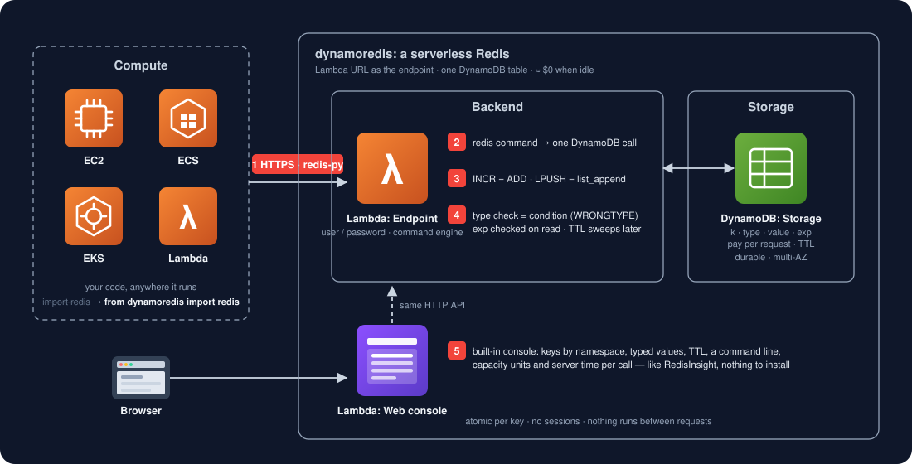

# dynamoredis —— 真正 serverless 的 Redis

> **ElastiCache / Redis** 空闲也按小时计费。**dynamoredis** 用 **一张 DynamoDB 表 + 一个 Lambda Function URL**
> 做同样的事，没人用时 ≈ $0。客户端 API 一样（redis-py）；哪天长大了，改一行 import 就回到真 Redis。

[English](README.md) · [兼容性报告](tests/compat/REPORT.md) · [任务](tests/compat/TASKS.md) · [更新日志](CHANGELOG.md)



| | ElastiCache Serverless (Redis) | dynamoredis |
|---|---|---|
| 空闲费用 / 月 | ~$90（最低数据量 + ECPU） | ≈ $0 |
| 端点 | host:6379，RESP 协议，要进 VPC | Lambda Function URL，HTTPS，哪里都能连 |
| 存储 | 节点内存 | 一张 DynamoDB 表（按请求计费、TTL、多 AZ、持久） |
| 客户端 | `import redis` | `from dynamoredis import redis` |
| 控制台 | RedisInsight | 自带 web 控制台（Lambda URL） |
| 客户端兼容性 | — | [见报告](tests/compat/REPORT.md) |

## 为什么

大部分 Redis 用法是缓存、几个计数器、会话、小队列——一阵忙一阵闲，闲着 ElastiCache 照样每小时收钱。
DynamoDB 本身就是 serverless 的 KV 库，自带原子计数、集合、列表和 TTL，缺的只是 Redis 的 API。
dynamoredis 补上它：一个 Lambda 把 redis 命令翻译成 DynamoDB 调用，驱动说的是 redis-py。

## 原理

代码用 HTTP Basic（服务的 user / password）调 Lambda Function URL；Lambda 把每条命令变成对一张 DynamoDB 表的
操作——一条 item = key、类型、值、可选的过期时间。Redis 原子的地方 DynamoDB 也原子：`INCR` 是 `ADD`，`LPUSH` 是
`list_append`，`SADD` 是集合 `ADD`，类型不对是条件失败（`WRONGTYPE`）。过期在读的时候立刻生效，DynamoDB 的 TTL
之后再把 item 清掉。命令返回即已持久、多 AZ，没有节点会内存耗尽。

## 快速开始

### 1. 部署（二选一）

**Terraform**

```bash
cp terraform/example.json terraform/my.json      # 改 aws_profile、env、user、password
terraform -chdir=terraform init
terraform -chdir=terraform apply -var-file=my.json
terraform -chdir=terraform output                 # console_url
terraform -chdir=terraform destroy -var-file=my.json   # 全部拆掉（表也一起删）
```

**CloudFormation**（只需要 AWS CLI）

```bash
cp cloudformation/example-params.json cloudformation/params.json
aws cloudformation package --template-file cloudformation/template.yaml \
    --s3-bucket <你自己任意一个桶> --output-template-file /tmp/dynamoredis.yaml
aws cloudformation deploy --template-file /tmp/dynamoredis.yaml --stack-name dynamoredis \
    --capabilities CAPABILITY_IAM --parameter-overrides file://cloudformation/params.json
```

两种方式建出来的东西一样：一张 DynamoDB 表（`<name>-<env>`，按请求计费，`exp` 上开 TTL）、一个带公网
Function URL 的 Lambda、一个最小权限 IAM role。

### 2. 打开控制台

浏览器打开 `console_url`，用 `user` / `password` 登录。左边按前缀列 key（SCAN），右边按类型展示值（string、hash、
list、set、zset）和 TTL，上面是命令行——`SET greeting hello`、`HGETALL user:1`、`ZADD board 10 alice`。
每次调用显示服务端耗时和消耗的 DynamoDB 容量单位。

### 3. 程序连接

```bash
pip install dynamoredis
```

```python
from dynamoredis import redis        # 以后换真 Redis:`import redis`,其他不动

r = redis.Redis(host="xxx.lambda-url.us-east-2.on.aws", username="admin", password="...")
r.set("greeting", "hello", ex=60)
r.get("greeting")                    # b"hello"  (decode_responses=True -> "hello")
r.incr("hits")                       # 原子
r.hset("user:1", mapping={"name": "alice", "age": 30}); r.hgetall("user:1")
r.rpush("queue", "job-1", "job-2"); r.lpop("queue")
r.zadd("board", {"alice": 10, "bob": 20}); r.zrange("board", 0, -1, withscores=True)
with r.pipeline(transaction=False) as p:   # 一批一个 HTTP 请求
    p.set("a", 1); p.get("a"); p.execute()
```

## 兼容性

[tests/compat/REPORT.md](tests/compat/REPORT.md) 每次跑测试自动生成：同样的 redis-py 调用在 Docker 里的真
Redis 7 和 dynamoredis 上各跑一遍，比对返回值（含类型）和错误。

| 状态 | 含义 |
|---|---|
| ✅ verified | 与 redis-py 对 Redis 7 的结果一致，可放心依赖 |
| ❌ gap | 已知差异，备注指向 [TASKS.md](tests/compat/TASKS.md) 里修它的任务 |
| ⚪ quirk | Redis 的怪行为，故意不模仿 |
| ⛔ unsupported | 明确拒绝（`NotSupportedError`），绝不静默走样 |

自己跑一遍——和 CI 每次 push 跑的一样：

```bash
python3 -m pip install pytest boto3 moto redis
docker compose -f tests/compat/docker-compose.yml up -d redis
REDIS_URL=redis://127.0.0.1:6379/0 python3 -m pytest tests -q      # 生成 tests/compat/REPORT.md
docker compose -f tests/compat/docker-compose.yml down
COMPAT_DRY=1 python3 -m pytest tests/compat -q -s                  # 不用 Docker:只跑 dynamoredis 这边
```

**不支持的**——抛 `NotSupportedError`，绝不静默出错：pub/sub、阻塞命令（`BLPOP` …）、Lua / functions、
`MULTI` / `EXEC` / `WATCH`（`pipeline(transaction=True)`）、streams、`CONFIG` / `CLIENT` / 复制 / 集群。
这些都需要一个保持连接和会话的服务器，这里没有。

## 保证

| | 靠什么 |
|---|---|
| **原子性** | 一条命令 = 一次带条件表达式的 DynamoDB 操作；计数、push、集合增删都是服务端的 `ADD` / `list_append` / `DELETE` |
| **持久性** | DynamoDB 提交（多 AZ）之后客户端才拿到回复 |
| **隔离性** | 按 key，和 Redis 一样；没有跨 key 事务（`MULTI` 拒绝，见 TASKS.md task 1） |
| **过期** | 每次读都检查 `exp`，过期的 key 立刻不可见；DynamoDB TTL 几小时内回收 item |
| **绝不重复写** | 驱动只在"请求确定没送达"时重发；超时抛 `TimeoutError`，结果未知 |
| **可用性** | Lambda 和 DynamoDB 是区域级、多 AZ 的服务：没有节点会挂、没有 failover、没有维护窗口 |

## 适合谁

缓存、计数器、限流、会话、功能开关、Lambda 轮询的小工作队列——大部分时间闲着的东西。延迟是 HTTPS +
DynamoDB（几十毫秒，不是微秒），`KEYS` / `DBSIZE` 要扫全表。需要 pub/sub、阻塞 pop、Lua 或事务的时候，
就是该换真 Redis 的时候——见 [MIGRATION.md](MIGRATION.md)。

## 目录

```
src/server/       服务本体:lambda_function.py(HTTP API + 控制台)、engine.py(redis → DynamoDB)、index.html
client/           pip 包 dynamoredis:dynamoredis/redis.py、pyproject.toml
terraform/        部署方式 A
cloudformation/   部署方式 B
tests/            回归测试(moto);tests/compat/ 兼容性测试、REPORT.md、TASKS.md
```

## 发版

CI 每次 push 跑全部测试（含 Redis 对比）。发版就是打 tag：改 `client/pyproject.toml` 和
`client/dynamoredis/__init__.py` 的版本号，写 CHANGELOG，提交，然后 `git tag vX.Y.Z && git push --tags`
（测试 → 构建 → PyPI；tag 必须等于版本号）。

---

**[Redefine AWS Serverless](https://github.com/topics/redefine-aws-serverless)** 系列之一——把空闲也计费的 AWS 服务，
用空闲 ≈ $0 的原语重做一遍。MIT。
